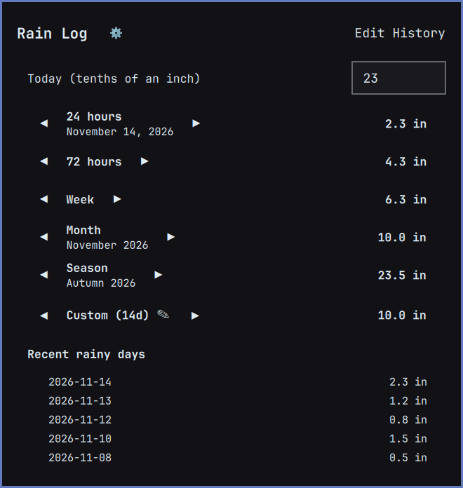
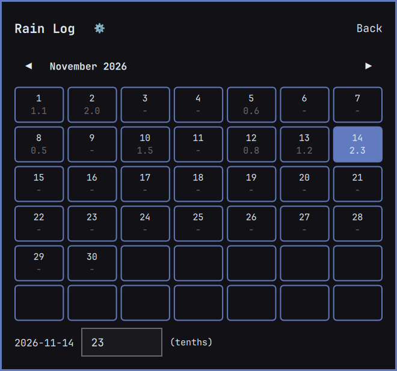
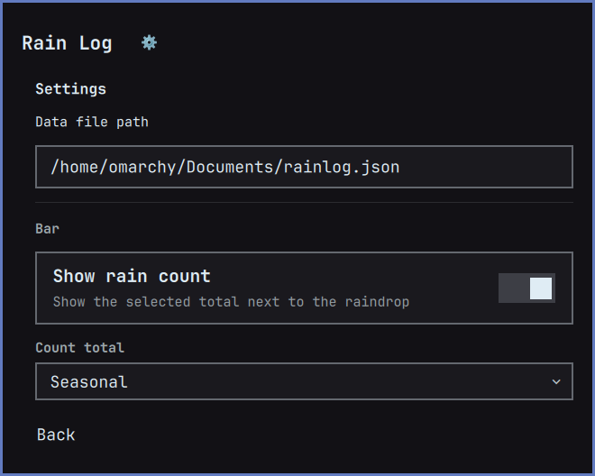

# Rain Log

Are you a gardener who wants a better way to keep track of hyper-local rainfall totals from the gauge in your yard?

Rain Log is a small Omarchy shell plugin that turns your daily gauge reading into a rolling record you can actually use: today, the last three days, the last week, this month, this season, or any custom window you choose. It keeps a calendar history, shows your most recent rainy days at a glance, and can put the total next to a raindrop in the bar.



*The main page after a few days of readings: today's gauge value, rolling totals, and the most recent rainy days.*

## Ways Rain Log helps in the garden

- **Measure your garden, not the airport.** Record the number from the gauge in your yard instead of relying on a weather app reporting for a station miles away.
- **Know whether the soil got a real soak.** The 24-hour, 72-hour, and 7-day totals separate a passing sprinkle from rain that actually reached the roots.
- **Watch the month and the season.** Monthly and seasonal totals show whether you are ahead of or behind your usual pattern.
- **Track a specific window.** The custom range (14 days by default) is handy for seed starting, transplanting, or following a dry spell.
- **Scrolling history.** Use the ◀ / ▶ arrows to step any period backwards and compare this week with last week, or this month with last month.
- **Catch up on missed readings.** The calendar keeps one value per day, so you can fill in a missed day or correct a typo without disturbing the rest of the record.
- **See the recent rainy days.** The last five days with rain stay visible with their totals, even when they cross a week or month boundary.
- **Put it on the bar if you want it.** Show a raindrop plus a daily, weekly, monthly, seasonal, or yearly total in the Omarchy bar. The count is hidden by default, leaving just the raindrop.
- **Own the data.** Everything lives in a small local JSON file. There is no account, no cloud, and no network access.
- **Match your desktop.** Colors, fonts, spacing, controls, and the popup chrome all follow the active Omarchy theme.

## Calendar and edit history



Click **Edit History** to open the current month. Every cell shows the day number and that day's total in inches, or `-` when nothing was recorded. The selected day is highlighted.

- Use the ◀ / ▶ arrows to move between months.
- Click any day, then type its reading in the field below the calendar and press Enter.
- Entering `0` or clearing the field removes that day's entry.
- **Back** returns to the main page.

## Settings and the bar readout



The settings page keeps the data file path and controls the optional bar readout:

- **Data file path** — where the JSON history is stored.
- **Show rain count** — off by default. When off, the bar shows only the raindrop.
- **Count total** — when the count is visible, choose **Daily**, **Weekly**, **Monthly**, **Seasonal**, or **Yearly**.

The bar value always reflects the current period, even if you scroll the popup back through older totals.

## Measurements

Rain Log uses tenths of an inch, matching the markings on a standard US rain gauge:

- Enter `23` for 2.3 inches of rain.
- Totals are displayed in inches with one decimal place.
- The 24-hour row is a single calendar day, and its arrows move one day at a time.
- Weeks are the last seven calendar days including today.
- Months and years are calendar periods.
- Seasons are meteorological: December–February, March–May, June–August, and September–November.

## Installation

Rain Log requires Omarchy 4.x with `omarchy-shell` (Quickshell). It has no extra dependencies and does not run a background service.

Install from the repository:

```bash
omarchy plugin add https://github.com/captain-reginald/omarchy-rain-log --enable
```

`--enable` also asks where to place the widget on the bar.

To install without enabling it immediately:

```bash
omarchy plugin add https://github.com/captain-reginald/omarchy-rain-log
omarchy plugin enable io.github.captain-reginald.rainlog
```

### Update

```bash
omarchy plugin update io.github.captain-reginald.rainlog
```

### Remove

```bash
omarchy plugin remove io.github.captain-reginald.rainlog
```

Removing the plugin leaves the data file in place. Delete `~/Documents/rainlog.json` yourself if you also want to remove the rainfall history.

## Data file

By default the history is stored at `~/Documents/rainlog.json`. The format is deliberately simple:

```json
{
  "entries": {
    "2026-11-14": 23,
    "2026-11-13": 12,
    "2026-11-12": 8
  }
}
```

Each value is in tenths of an inch, so `23` means 2.3 inches. The file is written as soon as you commit a reading. Change the location in Settings if you keep your documents somewhere else.

## Repository layout

```text
.
├── manifest.json
├── README.md
├── LICENSE
├── .gitignore
├── preview.png
├── BarWidget.qml
├── Panel.qml
├── Model.js
├── i18n/
│   └── en.json
└── screenshots/
    ├── calendar.png
    └── settings.png
```

## License

Rain Log is free software: you can redistribute it and/or modify it under the terms of the GNU General Public License as published by the Free Software Foundation, either version 3 of the License, or (at your option) any later version.

It is distributed in the hope that it will be useful, but **without any warranty**; without even the implied warranty of merchantability or fitness for a particular purpose. See [LICENSE](LICENSE) for the full text.

Copyright © 2026 Captain Reginald.
